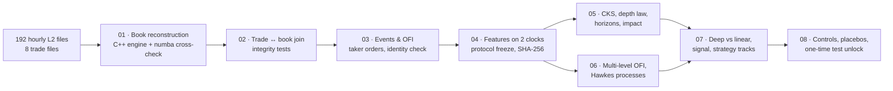

# Microstructure Alpha

**Order-flow signal research and execution simulation on Binance ETHUSDT perpetual futures, from full-depth L2 data.**

I rebuild the limit order book exactly from raw diff-depth messages, measure order-flow imbalance (OFI) at every update, and test seven pre-registered hypotheses about how order flow moves prices. I then build a latency-aware trading signal and evaluate three ways to use it: timing execution, market making and directional taking. Every modelling and strategy choice was frozen before the held-out test days were opened, and they were opened exactly once.

| | |
|---|---|
| **Instrument** | Binance USD-M ETHUSDT perpetual |
| **Period** | 7–14 September 2026 (8 days) |
| **Raw data** | 192 hourly L2 diff-depth files (~4.1 GB) + 8 daily trade files (~1.8 GB) |
| **Scale** | 25.7M book update batches · 35.3M trades · 5.86M taker orders |
| **Stack** | C++17, Python, Numba, NumPy, Pandas, PyArrow, PyTorch, Matplotlib |

---

## Headline results (held-out test days D7–D8)

| Result | Number |
|---|---|
| **Signal-timed execution vs TWAP** (50 ETH parents, 130 ms latency, 600 parents) | **0.339 bp saved**, 95% CI [0.309, 0.370] |
| **Part of that saving due to the signal** (vs a matched-delay placebo) | **0.318 bp**, 95% CI [0.272, 0.357] |
| Delay-only controls (last second / random / matched delay) | 0.020 / −0.004 / 0.021 bp, none significant |
| Signal information coefficient (1 s ahead, zero latency) | **0.172** [0.160, 0.185]; 79% kept at 130 ms |
| OFI vs traded volume, share of 1 s price variance explained | **43–50% vs 26–37%** |
| Price impact vs touch depth (log–log slope) | −0.87 [−0.95, −0.77] (dev: −0.965 [−1.01, −0.91]) |
| Passive market making | **Rejected**: −26.2 ticks/ETH 5 s markout; break-even needs a 0.91 bp rebate |
| Pre-registered hypotheses whose verdict replicated on the test days | **7 / 7** |

The execution edge is a cost reduction, not a stand-alone profit: about $4 on a $125k parent order. It is statistically robust and survives every placebo. Its economic value grows with execution volume.

---

## Contents

1. [Pipeline](#pipeline)
2. [Repository layout](#repository-layout)
3. [Data](#data)
4. [Stage 0 — exact book reconstruction](#stage-0--exact-book-reconstruction)
5. [Events, OFI and taker orders](#events-ofi-and-taker-orders)
6. [Features on two clocks](#features-on-two-clocks)
7. [Research protocol](#research-protocol)
8. [Hypotheses and results](#hypotheses-and-results)
9. [Classic microstructure measures](#classic-microstructure-measures)
10. [Multi-level OFI and Hawkes processes](#multi-level-ofi-and-hawkes-processes)
11. [Deep vs linear models](#deep-vs-linear-models)
12. [The trading signal](#the-trading-signal)
13. [Strategy tracks](#strategy-tracks)
14. [Robustness and the test unlock](#robustness-and-the-test-unlock)
15. [Limitations](#limitations)
16. [How to run](#how-to-run)
17. [References](#references)

---

## Pipeline



| Notebook | Stage | What it does | Runtime* |
|---|---|---|---|
| `01_book_reconstruction` | 0 | Rebuilds the book from diff-depth messages with the C++ engine and checks it batch-for-batch against an independent numba engine | ~15 min |
| `02_trades_and_join` | 0 | Loads 35.3M trades, joins each to the book batch it executed in, classifies every fill, finds data-quality windows | ~10 min |
| `03_events_and_ofi` | 1 | Per-batch touch decomposition, OFI at levels 1–10, exact identity check, taker-order rebuild, six hand-checked batches | ~3 min |
| `04_features_and_protocol` | 2–3 | RPI hypothesis test, 100 ms feature grid on exchange and received clocks, **protocol freeze** | ~4 min |
| `05_cks_and_classics` | 4–6 | Spread decomposition, Kyle's λ, sign memory and propagator, CKS regressions, horizon curve, depth law, clock vs event time | ~30 min |
| `06_multilevel_and_hawkes` | 7, 9 | Model ladder (levels 1–10, ridge, lasso, PCA, microprice), Hawkes kernels, six-stream excitation, Hawkes features | ~60 min |
| `07_deep_and_strategy` | 10, 8 | Linear vs ridge vs CNN, received-clock signal, latency decay, Tracks A/B/C | ~15 min |
| `08_robustness_and_test` | 11 | Signal diagnostics, Track A placebo controls, **test unlock**, sensitivity surfaces, deflated Sharpe | ~30 min |

\*On a Windows laptop with the data on a local SSD.

---

## Repository layout

```
cpp/
  CMakeLists.txt
  include/l2_format.hpp     binary record format shared with Python (exact integer rows)
  include/book.hpp          tick-indexed order book with incrementally tracked best prices
  src/book.cpp
  src/book_builder.cpp      CLI: replays one hour (or segment), carries the book between hours in a state file
  tests/test_book.cpp       unit tests on hand-built books
notebooks/
  01_book_reconstruction.ipynb … 08_robustness_and_test.ipynb
  ma_lib.py                 shared library (parsing, numba engine, events, features, statistics, Hawkes, simulators)
```

The data and generated outputs aren't in the repository (see [Data](#data)).

---

## Data

**L2 diff-depth (one parquet file per hour).** Each file opens with a full-depth snapshot (about 37k price levels, carrying `lastUpdateId` = *L*). One update message follows per matching-engine batch, about every 27 ms. Each message carries `first_update_id` *U*, `final_update_id` *u*, `prev_final_update_id` *pu*, the matching-engine `transaction_time` and the local `received_time`. `quantity` is the **new absolute size** of a level, and 0 removes it.

**Trades (one CSV per day).** Trade ID, price, quantity, quote quantity, time and aggressor side.

**Prices and sizes are parsed exactly.** Prices become integer ticks (0.01 USDT) and sizes integer lots (0.001 ETH), read from the decimal strings through a `decimal128` cast with no floating point. A tick is about 0.04 bp at ETH ≈ 2,500 USDT.

**Two clocks.**

| Clock | Source | Used for |
|---|---|---|
| Exchange time *T* | `transaction_time` | research: what the market did |
| Received time *R* | `received_time`, median 127 ms after *T* | trading: what a participant could know |

---

## Stage 0 — exact book reconstruction

### Binance futures sync rules

Update IDs **skip** between messages (the median jump is 143), so the spot-market test "*U* = *L* + 1" is wrong. It produced a false "194-ID gap" early in this project. The futures rules are:

1. After a snapshot, the stream is linked if the first message has `pu == L` (fallback: drop messages with *u* < *L*, then require *U* ≤ *L* ≤ *u*).
2. Every later message must have `pu ==` the previous message's *u*. A break marks the book invalid until the next snapshot.

### Real-world file structure

Only 19 of 192 files have the textbook layout of one snapshot followed by updates:

- From 7 Sep 15:00 onward, most files have **no snapshot at all**. They continue the previous hour's message chain.
- 12 files contain a **second snapshot mid-hour**, where the recorder reconnected.

Each file is therefore split into **segments** at every snapshot. Each segment is assigned a mode:

| Mode | Count | Meaning |
|---|---|---|
| `continued` | 169 | No snapshot; `pu` links to the book carried from the previous file |
| `snapshot_linked` | 23 | Snapshot, and the first message satisfies the sync rule |
| `snapshot_bracket` | 12 | Mid-hour reconnect: snapshot after a `pu` break; the book is invalid between break and snapshot |

### Two independent engines

| | Role |
|---|---|
| **C++17 book builder** | Production engine. Tick-indexed arrays with incrementally tracked best bid and ask; it writes top-10 levels after every batch and carries non-empty levels between hours in a state file |
| **Numba engine** (`ma_lib.BookBuilder`) | Independent reference implementation fed from the same parsed data |

**Acceptance gate:** identical output on every batch of every hour.

| Check | Result |
|---|---|
| C++ == numba, every batch, every hour | **192 / 192 hours** |
| Exact top-20 audits where a snapshot and the replay share an update ID | **22 / 22** |
| Crossed books in valid batches | **0** |
| Update IDs strictly increasing, exchange time non-decreasing | everywhere |
| Recorder reconnects (`pu` breaks) | 12 events, 413 breaks; 514,593 batches (2.0%) flagged invalid and excluded |

### Trade ↔ book join

All 35.3M trades were checked against the reconstructed book:

- 99.999% matched to a book batch.
- 98.37% of trades fall in valid book periods.
- 0.394% of trade IDs are missing. The missing IDs don't consume visible liquidity: the depletion ratio between gap and non-gap batches is 1.04.

**Unexplained trades: 0.943% of trades (2.475% of volume)** print at prices the batch-level book can't account for. The investigation:

| Test | Result |
|---|---|
| Share of unexplained trades in fast batches (\|Δmid\| ≥ 4 ticks) | **90.1%**, concentrated in the 11 Sep 12:30–14:03 UTC fast market |
| Explained by timestamp drift (±5 batches) | only 18.8%, so drift is ruled out |
| RPI hypothesis (hidden Retail Price Improvement liquidity) | R1 passed (95.3% better than visible); **R2 failed** (24.0% within 1–3 ticks vs ≥ 80% required); **R3 failed** (82.3% coincide with a visible queue drop) |

**Conclusion:** most unexplained prints are round trips inside a single ~27 ms batch. A sweep moves the price and the book refills before the batch boundary. The pre-registered quiet-batch threshold (≤ 0.05%) failed at 0.23%, so **Stage 0 is recorded as NOT PASSED** in the frozen protocol. The book itself is verified exactly; the limitation is the batch resolution of the depth feed.

---

## Events, OFI and taker orders

For every batch, with pre-state *p* and post-state *n*, the level-ℓ **Cont–Kukanov–Stoikov OFI** is

$$
e_\ell = \mathbb{1}[P^b_n \ge P^b_p]\,q^b_n - \mathbb{1}[P^b_n \le P^b_p]\,q^b_p - \mathbb{1}[P^a_n \le P^a_p]\,q^a_n + \mathbb{1}[P^a_n \ge P^a_p]\,q^a_p
$$

applied to the ℓ-th level of each side.

**Touch decomposition.** Level-1 OFI splits exactly into three flows:

| Component | Definition | Share of OFI variance |
|---|---|---|
| Limit flow | net adds minus cancels at an unchanged touch, *N* = Δq + V | 17.8% |
| Market flow | executions at an unchanged touch | 1.7% |
| Move flow | the queue gained or lost when the touch price moves (improve, sweep out, cancel out) | **80.5%** |

The identity OFI₁ = limit + market + move was checked on all 25.2M valid batches with **0 violations**. Six batch types are printed term by term and verified three ways: the vectorised engine, an independent scalar implementation, and values computed separately and embedded in the notebook.

**Taker orders.** Consecutive trade IDs with the same timestamp and side form one taker order, giving 5.86M orders. Each fill is one resting maker order, so fill sizes reveal the real queue composition: the median resting order is 0.04 ETH and the p90 is 2.3 ETH. 99.7%+ of taker orders walk the book in price order on every day.

**Limitation:** adds and cancels inside one batch net out. *N* is exact, but separate add and cancel volumes are lower bounds. OFI needs only the net, so it is unaffected.

---

## Features on two clocks

A 100 ms grid on each clock: 864,000 bins per day, 6.9M per clock in total.

| Clock | Valid bins | Validity rule |
|---|---|---|
| Exchange (research) | 97.88% | book state valid, no invalid batch in the bin |
| Received (trading) | 97.85% | as above, plus feed latency ≤ 1 s and state age ≤ 1 s |

- **Flows** (summed per bin): OFI levels 1–10, limit/market/move flow, buy and sell volume, volume excluding RPI candidates, taker-order counts, sweeps, realised variance, mid changes.
- **States** (last batch known at the bin end, forward-filled): top-of-book prices and sizes, depth to 5 and 10 levels, price span, feed latency, state age.

**Leak guard.** On the received clock a batch belongs to the bin of its *received* time, and trades inherit their batch's received time. Trade-derived features are aligned to the batch they landed in, never to the raw trade timestamp. An early version used raw trade times against a book-based target and produced a spurious 7.5% R²; the batch alignment removed it.

---

## Research protocol

`protocol/protocol.json` was written **before any feature was related to a future price** and hashed with SHA-256 (`0224381a…34af`). Every later notebook verifies the hash and refuses to run if a single character changed.

| Element | Setting |
|---|---|
| **Data split** | development D1–D5 (7–11 Sep) · selection D6 (12 Sep) · test D7–D8 (13–14 Sep) |
| **Walk-forward** | expanding by day within development |
| **Selection rule** | every model and strategy choice frozen after evaluation on D6 |
| **Test rule** | test days evaluated once, in notebook 08; a ledger (`protocol/test_unlock.json`) records the unlock time and the hash of the frozen choices |
| **Embargo** | 10 minutes at day edges |
| **Inference** | Newey–West HAC (lags = ⌈h/bucket⌉ + 5); 5-minute moving-block bootstrap, 1,000 reps; Diebold–Mariano on squared errors; Romano–Wolf stepdown (studentized); Holm correction; OOS R² against the zero forecast |
| **Costs** | maker fee grid −0.5 / 0 / 1 / 2 bp, taker 2.5 / 4 / 5 bp; every strategy reported across the full grid |
| **Latency grid** | 0 / 50 / 130 / 250 ms |
| **Kill criteria** | max drawdown > 3× daily PnL std; 5 s markout worse than spread captured; alpha half-life < send latency |

All statistics are implemented from scratch in NumPy (no SciPy or statsmodels).

---

## Hypotheses and results

| | Hypothesis (pre-registered) | Development D1–D5 | Test D7–D8 |
|---|---|---|---|
| **H1** | Contemporaneous 1 s: ΔP = α + β·OFI₁, β > 0 every day; OFI R² > trade-imbalance R² | ✅ OFI R² 0.33–0.56 vs TI 0.24–0.28; 5/5 days | ✅ OFI 0.43 / 0.50 vs TI 0.37 / 0.26 |
| **H2** | β ∝ 1/depth: log β vs log D̄ slope CI excludes 0 | ✅ −0.965 [−1.009, −0.914], includes −1 | ✅ −0.868 [−0.946, −0.773] |
| **H3** | Lagged OFI predicts ΔP out of sample above a permutation null (Romano–Wolf) | ✅ significant 0.1–30 s; OOS R² 1.8% at 100 ms | ✅ significant 0.1–30 s; OOS R² 2.3% at 100 ms |
| **H4** | Event-time windows beat clock-time windows (DM) | ❌ | ❌ (mid-change clock won, volume clock lost) |
| **H5** | Multi-level / integrated OFI beats level-1 OFI **and** the microprice | ❌ | ❌ (beats OFI₁ at 100 ms, never the microprice) |
| **H6** | Taker-order signs have long memory (γ < 1); impact is transient | ✅ γ = 0.295 [0.25, 0.34]; kernel β = 0.18 [0.13, 0.23] | ✅ γ 0.44 / 0.36; kernel β 0.20 / 0.175 |
| **H7** | Hawkes intensity features add OOS R² beyond OFI (DM) | ✅ up to 1 s, gain ≤ 0.59 pts | ✅ up to 1 s, gain 0.24–0.28 pts |

**All seven verdicts were the same on the test days.** The two negative results (H4, H5) are reported as findings: deeper book levels add nothing beyond what the queue imbalance at the touch already says.

**Controls:**

- Shuffling OFI collapses the contemporaneous R² from 0.49 to 0.00001.
- The open-snapshot version of the depth law is attenuated toward 0 (−0.49 on dev, −0.32 on test), as errors-in-variables predicts.

---

## Classic microstructure measures

Development days, per taker order:

| Measure | Value |
|---|---|
| Effective spread | 0.276 bp |
| Realised spread (5 s) | **−0.514 bp**: makers lose on average |
| Price impact (adverse selection) | 0.790 bp |
| Kyle's λ | 0.067 ticks/ETH (R² 0.26, vs OFI R² 0.49) |
| Concave size impact | immediate impact ∝ size^0.25 |
| β relative to the CKS benchmark 1/(2D̄) | **6.7–8.3× larger** |

The last row describes the book's shape: a **wall at the touch, a vacuum behind it**. Mean depth is dominated by occasional large queues, while OFI hits when the touch is thin, so the harmonic mean depth is the fairer normaliser.

---

## Multi-level OFI and Hawkes processes

### Model ladder (walk-forward OOS R², development)

| Horizon | Microprice | OFI₁ | Levels 1–10 | Ridge | PCA-integrated | **OFI₁ + microprice** |
|---|---|---|---|---|---|---|
| 0.1 s | 2.48% | 1.83% | 1.98% | 1.98% | 1.49% | **3.43%** |
| 0.5 s | 3.38% | 1.20% | 1.19% | 1.19% | 0.66% | **3.60%** |
| 1 s | 3.60% | 0.92% | 0.92% | 0.92% | 0.60% | **3.66%** |
| 5 s | 2.53% | 0.32% | 0.28% | 0.25% | 0.18% | 2.52% |

On the test days, OFI₁ + microprice reached 3.9–4.7% from 0.1 to 1 s.

### Hawkes processes

The Hawkes code is exact EM for multivariate Hawkes processes with fixed decay rates, written in numba. It was validated on simulated data before use. Same-millisecond ties are jittered, and the jitter sensitivity of the branching ratio is 0.001.

- **Kernel choice:** exponential, two-exponential and a 12-exponential multi-scale kernel (0.1–1,000 s⁻¹, able to represent power-law decay) were compared by held-out log-likelihood. The multi-scale kernel wins. Time-rescaling KS distances are reported.
- **Branching ratio** (exponential kernel, hourly fits): 0.42 [0.40, 0.43]. This is an upper bound, because the baseline intensity is held constant within each hour.
- **Six-stream model** (buy and sell taker orders; bid and ask adds and cancels at the touch):

| Effect | Excitation |
|---|---|
| Taker-order self-excitation (order splitting / herding) | 0.44–0.46 |
| Ask cancel → buy taker | 0.037 ± 0.009 |
| Buy taker → ask cancel (liquidity flight) | 0.024 ± 0.011 |
| Sell taker → bid cancel (liquidity flight) | 0.018 ± 0.012 |

---

## Deep vs linear models

Six channels per 1 s bucket over the last 32 s; targets 1, 5 and 30 s ahead. **Acceptance rule, written before running:** a complex model must beat ridge in a Holm-adjusted Diebold–Mariano test on the dev walk-forward **and** beat it on D6.

| Model | Dev OOS R² (1 / 5 / 30 s) | D6 OOS R² (1 / 5 / 30 s) |
|---|---|---|
| Linear OFI₁ | 0.92% / 0.49% / 0.13% | 0.81% / 0.57% / 0.10% |
| Ridge, full 32 × 6 window | 3.61% / 2.08% / 0.36% | −0.08% / 1.80% / 0.65% |
| Causal dilated CNN | 1.97% / 1.33% / 0.27% | −1.80% / 1.23% / 0.40% |

The CNN lost to ridge (DM statistic −16.6 at 1 s), so the **linear model was deployed**.

---

## The trading signal

Every 100 ms on the **received clock**, using only information that had arrived by then, the signal combines:

- level-1 OFI (current bin and last 1 s) and 1 s trade imbalance
- queue imbalance and an empirical microprice (queue-imbalance decile → mean next move)
- net and total Hawkes excitation, with taker orders timed at their batch's received time

The target is the next-1 s mid change. The model is OLS, fit once on D1–D5 and frozen.

| | Dev (leave-one-day-out) | D6 (selection) | Test D7–D8 |
|---|---|---|---|
| IC at 0 ms | 0.151 | 0.131 | **0.172** [0.160, 0.185] |
| IC at 130 ms | 0.120 | 0.114 | **0.137** |
| OOS R² | 4.9% | −0.7% | 2.6% / 5.9% |
| Alpha half-life | 750 ms | > 1 s | 750 ms |

**Why the D6 R² was negative while the IC was positive.** The calibration slope on D6 was 0.47: the forecast ranked moves correctly but was about twice too large. Queue imbalance and the microprice are near-duplicates (correlation 0.95, VIF ≈ 9.5). On the test days the slope was 0.68 and 1.20.

**Leak checks.**

- **Future-shift placebo:** IC against moves 30 s to 5 min ahead is ≤ 0.005, inside the shuffle null.
- **Shuffle null:** circular shifts of at least 10 minutes give a 95th-percentile |IC| of 0.004–0.007.

---

## Strategy tracks

### Track A — signal-timed execution (headline)

**Setup:**

- A parent order of 50 ETH (random side, random valid start time) is worked over 10 minutes in 20 slots of 30 s.
- Children are marketable: they walk the exchange-time book after the send latency, and size beyond the top 10 levels is priced one tick worse.
- **Implementation shortfall** = side × (parent VWAP − arrival mid) / arrival mid, in bp.

**Strategies:**

- **TWAP** sends each child at the start of its slot.
- **Signal-timed** sends early when side × forecast ≥ θ_A (adverse move predicted), otherwise in the slot's last second.

θ_A = 2 ticks was chosen on development days and frozen. A leave-one-day-out choice picks 2.0 on all 5 folds.

**Controls**, defined before the test unlock:

| Control | What it isolates |
|---|---|
| Last second | pure delay |
| Random delay | random timing |
| **Matched delay** | the timed strategy's own delays, reassigned at random: same delay distribution, no information |
| Stale signal | the timed rule with the forecast from 60 s earlier |
| Reversed signal | the forecast's sign flipped |
| Price-only | send once the mid has moved 2 or 5 ticks in your favour (no OFI) |

**Results at 130 ms latency, saving vs TWAP (bp):**

| Strategy | Development (300 parents) | D6 (300) | **Test (600)** |
|---|---|---|---|
| **Signal-timed** | 0.338 [0.299, 0.382] | 0.205 [0.176, 0.237] | **0.339 [0.309, 0.370]** |
| Last second | 0.049 [−0.064, 0.156] | 0.000 | 0.020 [−0.056, 0.095] |
| Random delay | −0.026 | 0.005 | −0.004 |
| Matched delay | −0.032 | 0.016 | 0.021 [−0.013, 0.057] |
| Stale signal | −0.008 | −0.004 | −0.007 |
| Reversed signal | −0.344 | −0.221 | −0.335 |
| Price-only (2 ticks) | −0.167 | −0.104 | −0.162 |
| **Signal value = matched − timed** | 0.370 [0.306, 0.433] | 0.189 [0.151, 0.229] | **0.318 [0.272, 0.357]** |

**Robustness on the test days:**

- By latency: 0.373 / 0.358 / 0.339 / 0.313 bp at 0 / 50 / 130 / 250 ms.
- By parent size: 0.342 / 0.339 / 0.327 bp at 10 / 50 / 200 ETH.
- Positive for 82% of parents.
- By day: 0.30 bp on 13 Sep (Sunday) and 0.38 bp on 14 Sep (Monday). D6 was a quiet Saturday, which fits an edge that scales with activity.
- Deflated Sharpe probability 1.00 after deflating for the 5 thresholds tried.

**In cost terms:** shortfall goes from +0.24 bp (TWAP) to −0.10 bp. All-in with a 5 bp taker fee, cost falls from 5.24 to 4.90 bp (−6.5%).

### Track B — forecast-skewed market making (rejected)

**Simulator:** a numba queue-position simulator on the batch-level book.

- Quotes arrive after the send latency at the back of the touch queue.
- The queue ahead shrinks with executions at your price.
- Cancels ahead either never help (*pessimistic*) or advance you pro rata (*optimistic*).
- A sweep of your level fills you.
- Quotes are pulled on the side the forecast says is about to be run over.
- Inventory is capped at ±10 ETH.

| Test days (130 ms, pessimistic, skew on) | Value |
|---|---|
| Net PnL at a 2 bp maker fee | −4,243 USDT |
| Break-even maker fee | −0.91 bp (needs a rebate larger than the best tier, −0.5 bp) |
| 5 s markout | −26.2 ticks/ETH |
| Kill criteria | drawdown ✗, markout ✗ |

Gross PnL is negative in every configuration on every evaluation day, across all four latencies, both queue models, and with or without skew. The forecast skew cuts total losses by quoting less, but the fills it keeps are worse per ETH (break-even −1.35 bp with skew vs −0.49 bp without on D6). Neither overcomes adverse selection at non-colocated latency. Fills are also an upper bound, because hidden RPI orders can match retail flow ahead of visible makers.

### Track C — directional taker (no trades)

A taker round trip costs two taker fees plus about a tick: ≥ 127 ticks at the cheapest tier. The forecast's 99th percentile is 11.6 ticks (maximum 66), so **Track C never trades**. This is the correct outcome.

---

## Robustness and the test unlock

Notebook 08 runs in a fixed order:

1. **Re-create the frozen choices** deterministically. The coefficients reproduce notebook 07 exactly. They are written to `frozen_choices.json` with a hash.
2. **Signal diagnostics**, before the unlock:
   - collinearity (condition number 45, VIF)
   - per-day calibration
   - leave-one-day-out with 8 feature variants
   - IC-vs-latency curve with block-bootstrap CIs
   - future-shift placebo and shuffle null
   - data-handling sensitivity: excluding resync hours, excluding fast windows, and trade imbalance without RPI candidates (which changes R² by < 0.00002)
3. **Track A controls** on development days and D6, before the unlock, plus a θ grid extended past the frozen value as a diagnostic.
4. **Track B surface** on D6: θ_B × latency.
5. **Test unlock**: all hypotheses, the signal, all strategy tracks and every control, evaluated once on D7–D8.
6. **Sensitivity surfaces** (θ × latency, maker fee × latency) and **deflated Sharpe ratios**.

The rolling walk-forward over all 8 days (secondary, for transparency only) gives an IC between 0.16 and 0.25 on every day.

---

## Limitations

- **Short sample:** one instrument over 8 days.
- **Simulated fills:**
  - Execution walks the visible book with no impact feedback beyond it.
  - Hidden RPI liquidity isn't modelled.
  - Market-making fills are an upper bound.
- **Non-colocated capture:** feed latency is ~127 ms median, so results describe a non-colocated participant.
- **Batch resolution:** 0.94% of trades can't be placed in the ~27 ms batch-level book. This is recorded as a failed Stage-0 gate, not hidden.
- **Funding not modelled:** the dataset has no funding-rate series. All holding periods are under an hour.
- **Grid edge:** θ_A was frozen at the edge of the notebook-07 grid. The extended grid (diagnostic only) suggests a larger value would have done better on development days.
- **Hawkes branching ratios** are upper bounds (constant baseline per hour). Two hours had unreliable fits.

---

## How to run

### Requirements

- Python 3.10+ with `pip install numpy pandas pyarrow numba matplotlib torch` (`lightgbm` is optional)
- A C++17 compiler (tested with MinGW-w64 g++ 15.2 via MSYS2; CMake + MSVC also works)
- About 10 GB free disk space for intermediate outputs. Keep the data on a **local disk**: running from a cloud-synced folder made notebook 01 run about 7× slower.

### Build the C++ engine

```bash
cd cpp
mkdir -p build/Release
g++ -std=c++17 -O2 -Wall -static -Iinclude src/book.cpp src/book_builder.cpp -o build/Release/book_builder.exe
g++ -std=c++17 -O2 -Wall -static -Iinclude src/book.cpp tests/test_book.cpp -o build/Release/test_book.exe
./build/Release/test_book.exe        # prints "all Book tests passed"
```

Or with CMake:

```bash
cmake -S . -B build -DCMAKE_BUILD_TYPE=Release && cmake --build build --config Release
```

### Run the notebooks

1. Put the raw data in one folder (any sub-folder layout works; files are found by name):
   `ETHUSDT_orderbook_YYYYMMDD_HH.parquet` and `ETHUSDT-trades-YYYY-MM-DD.zip` (or `.csv`).
2. In the config cell at the top of each notebook, set `ROOT_DIR` (raw data) and `OUT_DIR` (outputs).
3. Run the notebooks **in order, 01 → 08**. Each one checks its inputs and stops with a clear message if something is missing.
4. Notebook 04 freezes the protocol. Notebook 08 opens the test days and writes the unlock ledger. Re-runs are allowed only with identical frozen choices.

Each notebook writes a `reports/NN_summary.md` plus CSVs and figures under `OUT_DIR/reports/`.

---

## References

- Cont, R., Kukanov, A. & Stoikov, S. (2014). The price impact of order book events. *Journal of Financial Econometrics*, 12(1).
- Kyle, A. S. (1985). Continuous auctions and insider trading. *Econometrica*, 53(6).
- Bouchaud, J.-P., Gefen, Y., Potters, M. & Wyart, M. (2004). Fluctuations and response in financial markets: the subtle nature of "random" price changes. *Quantitative Finance*, 4(2).
- Stoikov, S. (2018). The micro-price: a high-frequency estimator of future prices. *Quantitative Finance*, 18(12).
- Hawkes, A. G. (1971). Spectra of some self-exciting and mutually exciting point processes. *Biometrika*, 58(1).
- Bacry, E., Mastromatteo, I. & Muzy, J.-F. (2015). Hawkes processes in finance. *Market Microstructure and Liquidity*, 1(1).
- Diebold, F. X. & Mariano, R. S. (1995). Comparing predictive accuracy. *Journal of Business & Economic Statistics*, 13(3).
- Romano, J. P. & Wolf, M. (2005). Stepwise multiple testing as formalized data snooping. *Econometrica*, 73(4).
- Newey, W. K. & West, K. D. (1987). A simple, positive semi-definite, heteroskedasticity and autocorrelation consistent covariance matrix. *Econometrica*, 55(3).
- Bailey, D. H. & López de Prado, M. (2014). The deflated Sharpe ratio. *Journal of Portfolio Management*, 40(5).
- Binance USD-M Futures API documentation: "How to manage a local order book correctly" and the RPI order book.

---

*Author: Nitish Singh, IIT Kharagpur.*
